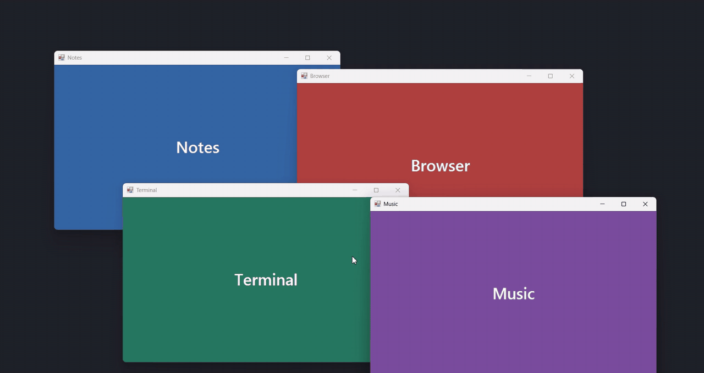

# Lattice

A nesting, zooming tiling window manager for Windows, written in Rust.

Drag a window to the edge of the screen and it docks; everything else makes room. Drop a window on the edge of another and they split that space. Splits nest inside splits as deep as you like. Then zoom: frame one window or one group full-screen, step back out, or show everything at once.



## Install

Grab `lattice.exe` from the latest [build](../../actions/workflows/build.yml) artifact, or build it yourself:

```powershell
cargo build --release
.\target\release\lattice.exe
```

Lattice lives in the system tray. Right-click the icon to show everything, open the overview or your templates, float every window, or quit.

## Using it

**Docking with the mouse**

- While you drag, a frosted panel shows exactly where the window will land. No panel means it will float where you drop it.
- Drag a window by its title bar until the pointer meets a screen edge to dock it there. The first window takes that half of the screen; the next fills the other half.
- Near either end of an edge, it stacks instead: top or bottom of the right edge puts it above or below what's docked on the right, and the ends of the top or bottom edge put it beside what's docked there.
- Push a window against the middle of the top edge to fill the screen with it. A docked window is framed where it sits; a floating one comes back to where you picked it up when you show everything again (`Ctrl+Alt+Space`).
- Drop it near the edge of a docked window to split that window's space.
- Drop it on another window's title bar to make them tabs, or hold Shift and drop it anywhere on the window. That works on docked and floating windows alike. They share that spot under a strip of tabs, and only the picked one shows; a floating group moves with its window. Drop more windows on the strip to add tabs.
- Drop it in the middle of the screen or of any window and it floats. Drop a docked window there to float it again.
- Maximized windows drag too: grab the title bar and the window restores under the pointer, as it does with Windows Snap on.
- Drag the border between two docked windows to resize both at once.
- Minimize a docked window and its neighbours take the space. Restore it and it comes back to the same spot, tab groups included.

**Tabs**

- Click a tab to show that window. Middle-click a tab to close its window.
- Drag a tab off the strip to take it out of the group, then drop it anywhere as usual: an edge docks it, the middle floats it, another title bar makes it a tab there.
- Drag the showing window by its own title bar, or the strip anywhere off its tabs, to move the whole group: to an edge to dock it there, or to the middle to float it.
- Tabs work with any app, because Lattice only moves windows. It never puts one app's window inside another's.
- Switching to a hidden tab with Alt+Tab or the taskbar shows it. The same goes for any docked window zoomed out of view: Lattice steps out until it's in view.

**Templates**

- Once your windows are docked how you like, open the **Templates** tab in the bottom-right corner (or press `Ctrl+Alt+T`), click *Save the current layout as a template* and give it a name.
- Click a template to fit the windows on the active display into that shape. Lattice keeps it loose:
  - Each window goes back to the spot its app had when you saved, if it can. The rest fill the spots in reading order, left to right and top to bottom.
  - Too few windows? Docked ones go first, then floating ones on that display. Spots nobody fills close up, and the windows beside them take the space.
  - Too many? Docked windows left over become tabs in the last spot, so nothing goes missing. Floating windows are only pulled in to fill spots.
  - Tab groups move as one.
- A window floating in the middle of the screen (where `Ctrl+Alt+F` puts one) is saved with the template too. Applying it puts a window of that app back in the middle, in front, and leaves it out of the docked spots.
- Click the ✕ beside a template to delete it. Saving under a name that's already taken replaces that template.
- Templates are kept in `%LOCALAPPDATA%\Lattice\templates.txt`, so they survive restarts.

**Overview**

- Press `Ctrl+Alt+Space` when everything is already showing and the whole arrangement steps back into the overview: every docked window as a card with a live picture of it, in the same layout, without moving or resizing the windows themselves.
- Click a card to go straight to that window, framed on its own. On a tab group's card, click a tab to pick it.
- `Enter` does the same for the card under the pointer. `Esc`, a click on the background, or switching to another window puts the overview away and leaves things as they were. `Ctrl+Alt+Space` again goes back to showing everything.
- Middle-click a card to close its window.
- Cards too small to make out show the app's icon instead, tinted with its colour.

**Keyboard**

| Shortcut | Action |
| --- | --- |
| `Ctrl+Alt+Space` | Show everything (again for the overview) |
| `Ctrl+Alt+Enter` | Frame the active window on its own, docked or floating (again to put a floating one back) |
| `Ctrl+Alt+Page Up` / `Page Down` | Previous / next tab in the active window's group |
| `Ctrl+Alt+Shift+Arrow` | Dock the active window at that edge, with its tabs |
| `Ctrl+Alt+F` | Float the active window in the middle of the screen, or put it back where it was: docked, or filling the screen |
| `Ctrl+Alt+Down` | Minimize the active window (restoring it puts it back in its spot) |
| `Ctrl+Alt+C` | Bring back the last minimized window (again for the one before) |
| `Ctrl+Alt+T` | Open or close your templates (also the Templates tab in the bottom-right corner) |
| `Ctrl+Alt+/` | Open or close the list of shortcuts (also the Keys tab in the bottom-right corner) |
| `Ctrl+Alt+Shift+Q` | Quit |

Each display keeps its own arrangement and camera.

## Tips

- **Turn off Windows Snap** (Settings → System → Multitasking → Snap windows). Snap and Lattice both act on edge drags. Lattice wins, but you'll see Snap's preview flash first.
- Some laptops bind `Ctrl+Alt+Arrow` to screen rotation (Intel graphics). If Lattice can't claim a shortcut, it lists the ones that were taken when it starts.
- **Recording your screen?** The drop-zone panel is hidden from screen captures. Set `LATTICE_RECORDING=1` before starting Lattice to show it in recordings.
- **Quitting is safe.** Quitting, or choosing *Float all windows*, puts every window back on screen. If Lattice ever crashes, a crash handler moves any off-screen window back into view.

## How it works

- `src/layout.rs` is the layout engine. It's pure Rust with no Windows code, and unit-tested. The desktop is a tree: leaves are windows, splits divide space by weight. The camera is a path into the tree, and zooming maps that node's rect onto the screen. Windows outside it land off-screen and are parked. A leaf can hold a tab group: the tree holds the showing tab, and the rest are parked behind it.
- `src/template.rs` saves and reads templates, and decides which window goes in which spot. It's pure Rust and unit-tested too.
- `src/win/` is the Windows layer. It hooks window events (`SetWinEventHook`) for drags, minimizes and closes, registers global hotkeys, and moves windows with async `SetWindowPos`, so a hung app can never freeze Lattice. Placement accounts for the invisible resize borders on Windows 10/11, so gaps are exact.

```powershell
cargo test   # layout engine tests, runs on any OS
```

## Roadmap

- Pinch-to-zoom on precision touchpads
- Saved views (`Ctrl+Alt+Shift+1–9` to save, `Ctrl+Alt+1–9` to recall)
- Persist arrangements across restarts
- Per-app rules ("don't arrange this app")

## License

MIT
